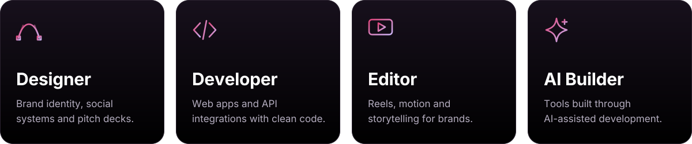

Hi, I'm Javeria Farhan, a brand designer and product designer and a Software Engineering student at Virtual University of Pakistan.

<!-- Instagram badge: add when @javeriafarhan is live

-->

 

## About Me

- **Hacktoberfest 2026:** Taking part in both the online events and the Fest hack days.
- **[VASLKAAR](https://vaslkaar.vercel.app):** Built an AI-powered operating system for freelancers solo in 5 days for the Pixel Forge AI Hackathon 2026. [Repository](https://github.com/Javeriaf19/vaslkaar)
- **HEC AI Training:** Took part in 2 hackathons during the programme.
- **[MLAB.pk](https://mlab.pk):** Full-time remote graphic designer and video editor since 2025.
- **NoteyStuff:** Project-based brand and product designer: branding, stationery, packaging and social media.
- **Rewriting the Code:** Active member of the community for women in tech.
- **Design:** Designing since 2020, starting with free thumbnails and posters. Portfolio: [javeriafarhan.me](https://javeriafarhan.me)
- **Building:** AI-powered products with JavaScript, Python and AI APIs, using AI-assisted development. Exploring robotics, with early ideas of my own.

 

 

## Featured

**VASLKAAR** is an AI-powered operating system for freelancers. It turns creative work into case studies and carousel decks, and handles invoices, a client CRM and AI roadmaps. I built it solo in 5 days for the Pixel Forge AI Hackathon 2026. [Live demo](https://vaslkaar.vercel.app)

<!-- Add new projects here in the same format -->

## Tech & Creative Stack

<h3 align="center">Programming & Frameworks</h3>

  

<h3 align="center">Creative Suite & Video</h3>

  

<h3 align="center">AI Engineering & Inference</h3>

  
  
  
  
  
  

## Journey

Exploring robotics now, with early ideas and learning in public.

## GitHub Stats & Streaks

## Contribution Graph

*Design makes it intuitive. Code makes it robust. AI makes it scalable.*

Open to design collaborations, remote design or front-end internships, and open source.

