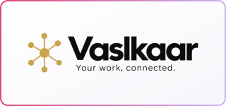

<h3>Hi, I'm Javeria Farhan, a brand and product designer, and a Software Engineering student at Virtual University of Pakistan.</h3>

<!-- Instagram badge: add when @javeriafarhan is live

-->

 

## About Me

- **Hacktoberfest 2026:** Taking part in both the online events and the Fest hack days.
- **[SafarGuard](https://safar-guard.vercel.app):** Built Pakistan's first autonomous winter highway safety radar and collision prevention system for Hacktoberfest Hack Day Lahore × AWS Student Builder Group. [Repository](https://github.com/Javeriaf19/SafarGuard)
- **[VASLKAAR](https://vaslkaar.vercel.app):** Built an AI-powered operating system for freelancers solo in 5 days for the Pixel Forge AI Hackathon 2026. [Repository](https://github.com/Javeriaf19/vaslkaar)
- **HEC AI Training:** Took part in 2 hackathons during the programme.
- **[MLAB.pk](https://mlab.pk):** Full-time remote graphic designer and video editor since 2025.
- **NoteyStuff:** Project-based brand and product designer: branding, stationery, packaging and social media.
- **Rewriting the Code:** Active member of the community for women in tech.
- **Design:** Designing since 2020, starting with free thumbnails and posters. Portfolio: [javeriafarhan.me](https://javeriafarhan.me)
- **Building:** AI-powered products with JavaScript, Python and AI APIs, using AI-assisted development. Exploring robotics, with early ideas of my own.

 

 

## Featured

  
  

**SafarGuard** is an autonomous winter highway safety radar and collision prevention engine for Pakistan's fog corridors (M-2, M-11, GT Road). It integrates AASHTO Stopping Sight Distance (SSD) physics with real-time Punjab telemetry, Night HUD driver guidance, and an urgent Roman Urdu audio beacon to prevent mass pileups before they happen. Built for Hacktoberfest Hack Day Lahore × AWS Student Builder Group. [Live Web App](https://safar-guard.vercel.app) · [AI Core](https://safarguard.streamlit.app) · [Demo Video](https://drive.google.com/file/d/10WbkxA8PQZYgdati7mDP6A3NZOF2tSXM/view?usp=sharing)

  
  

**VASLKAAR** is an AI-powered operating system for freelancers. It turns creative work into case studies and carousel decks, and handles invoices, a client CRM and AI roadmaps. I built it solo in 5 days for the Pixel Forge AI Hackathon 2026. [Live demo](https://vaslkaar.vercel.app)

  

**[awesome-mcp-for-creatives](https://github.com/Javeriaf19/awesome-mcp-for-creatives)** is a curated, open-source directory of Model Context Protocol (MCP) servers, tools, and workflows designed specifically for creative technologists, designers, and indie builders.

<!-- Add new projects here in the same format -->

## Tech & Creative Stack

<h3 align="center">Programming & Frameworks</h3>

  

<h3 align="center">Creative Suite & Video</h3>

  

<h3 align="center">AI Engineering & Inference</h3>

  
  
  
  
  
  

## Journey

Exploring robotics now, with early ideas and learning in public.

## Certifications & Achievements

  <!-- TODO: link to credential URL (owner to provide) -->
  
  <!-- TODO: link to credential URL (owner to provide) -->
  
  <!-- TODO: link to credential URL (owner to provide) -->
  
  <!-- TODO: link to credential URL (owner to provide) -->
  

  <!-- TODO: link to credential URL (owner to provide) -->
  
  <!-- TODO: link to credential URL (owner to provide) -->
  
  <!-- TODO: link to credential URL (owner to provide) -->
  
  <!-- TODO: link to credential URL (owner to provide) -->
  

## GitHub Stats & Streaks

## Connect with Me

  
  
  
  
  

## Contribution Graph

*Design makes it intuitive. Code makes it robust. AI makes it scalable.*

Open to design collaborations, remote design or front-end internships, and open source.

 

